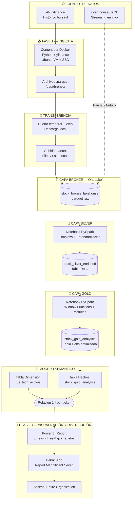

# 📈 Magnificent Seven Analytics — Pipeline de Datos en Microsoft Fabric

[](https://app.fabric.microsoft.com/)
[](https://spark.apache.org/)
[](https://www.python.org/)
[](https://powerbi.microsoft.com/)


Pipeline de ingeniería de datos **end-to-end** para la ingesta, procesamiento, enriquecimiento y analítica avanzada de las acciones de los **Magnificent Seven** (AAPL, MSFT, GOOGL, AMZN, NVDA, META, TSLA), implementado bajo una **arquitectura medallion (Bronze → Silver → Gold)** en **Microsoft Fabric**.

---

## 📑 Tabla de contenidos

- [🎯 Objetivo del proyecto](#-objetivo-del-proyecto)
- [🏗️ Arquitectura del pipeline](#️-arquitectura-del-pipeline)
- [🧩 Stack tecnológico](#-stack-tecnológico)
- [📂 Estructura del repositorio](#-estructura-del-repositorio)
- [🚀 Flujo por fases](#-flujo-por-fases)
  - [Fase 1 — Ingesta](#fase-1--ingesta)
  - [Fase 2 — Arquitectura Fabric](#fase-2--arquitectura-fabric)
  - [Fase 3 — Modelado y distribución](#fase-3--modelado-y-distribución)
- [📐 Métricas de negocio (Capa Gold)](#-métricas-de-negocio-capa-gold)
- [⚠️ Incidencias técnicas y soluciones](#️-incidencias-técnicas-y-soluciones)
- [🗺️ Roadmap](#️-roadmap)


---

## 🎯 Objetivo del proyecto

Construir una solución analítica corporativa que permita:

- **Centralizar** datos históricos bursátiles de los *Magnificent Seven* en un Lakehouse.
- **Estandarizar y enriquecer** los datos mediante transformaciones PySpark.
- **Calcular métricas financieras avanzadas** (rendimiento diario, volatilidad, media móvil).
- **Exponer la información** a través de un modelo semántico y un reporte interactivo en Power BI.
- **Distribuir** el cuadro de mando mediante una **Fabric App** con acceso corporativo.

---

## 🏗️ Arquitectura del pipeline



> 📎 La versión SVG exportada se encuentra en [`docs/architecture.svg`](docs/architecture.svg) (generada automáticamente por CI).

---

## 🧩 Stack tecnológico

| Categoría | Tecnología |
| :--- | :--- |
| **Origen de datos** | API pública `yfinance` |
| **Ingesta** | Docker · Python · Ubuntu VM · SSD |
| **Almacenamiento raw** | `.parquet` (Capa Bronze) |
| **Plataforma analítica** | Microsoft Fabric · OneLake |
| **Procesamiento** | Notebooks PySpark (Fabric) |
| **Formato tabla** | Delta Lake |
| **Modelado** | Semantic Model (Star Schema) |
| **Visualización** | Power BI |
| **Distribución** | Fabric App |
| **Streaming (roadmap)** | Eventhouse · KQL |


```
magnificent-seven-analytics/
├── README.md
├── docs/
│   ├── architecture.mmd          # Código fuente Mermaid
│   ├── architecture.svg          # Diagrama exportado (CI)
│   └── img/
├── notebooks/
│   ├── 01_bronze_ingesta.py      # Script de ingesta en Docker
│   ├── 02_silver_cleaning.ipynb  # PySpark — Limpieza
│   └── 03_gold_analytics.ipynb   # PySpark — Métricas financieras
├── docker/
│   ├── Dockerfile
│   └── docker-compose.yml
├── .github/
│   └── workflows/
│       └── mermaid-to-svg.yml    # GitHub Action
└── LICENSE
```

---

## 🚀 Flujo por fases

### Fase 1 — Ingesta

1. **Entorno de ejecución:** contenedor Docker sobre disco SSD en VM Ubuntu.
2. **Extracción:** consultas automatizadas a la API de `yfinance` para los 7 tickers.
3. **Persistencia raw:** archivos `.parquet` en `/data/bronze/`.

**Mitigación de rate limiting:**

```python
import time, random
from yfinance import Ticker

for ticker in TICKERS:
    data = Ticker(ticker).history(period="10y")
    data.to_parquet(f"/data/bronze/{ticker}.parquet")
    time.sleep(random.uniform(2, 5))  # jitter aleatorio
```

### Fase 2 — Arquitectura Fabric

| Capa | Objeto | Descripción |
| :--- | :--- | :--- |
| 🥉 **Bronze** | `stock_bronze_lakehouse` | Archivos `.parquet` crudos subidos a `Files` |
| 🥈 **Silver** | `stock_silver_enriched` | Tabla Delta normalizada (`CleanSymbol`, `CleanDate`) |
| 🥇 **Gold** | `stock_gold_analytics` | Métricas financieras avanzadas |

> ⚠️ **Reto de conectividad:** por restricciones de red entre la VM/SSD y OneLake, la transferencia se realizó mediante un **puerto temporal + descarga web**, seguida de una subida manual al Lakehouse.

### Fase 3 — Modelado y distribución

- **Modelo Semántico:** `Magnificent_Seven_Analytics` con relación **1 : \*** desde `us_tech_activos` (dim) hacia `stock_gold_analytics` (fact) por `ticker`.
- **Reporte Power BI:** líneas de evolución, tarjetas de rendimiento, TreeMap de volumen, segmentadores.
- **Fabric App:** `Report Magnificent Seven` publicada para *Entire Organization*.

---

## 📐 Métricas de negocio (Capa Gold)

```text
Daily_Return_Pct = ((closing_price − open_price) / open_price) × 100

Price_Spread     = high_price − low_price

SMA_5            = AVG(closing_price) OVER (
                     PARTITION BY ticker
                     ORDER BY date
                     ROWS BETWEEN 4 PRECEDING AND CURRENT ROW
                   )
```

Todas las métricas se redondean a **2 decimales** antes de su persistencia como tabla Delta optimizada.

---

## ⚠️ Incidencias técnicas y soluciones

| # | Incidencia | Causa | Solución aplicada |
| :--- | :--- | :--- | :--- |
| 1 | Requests denegadas (`rate limiting`) | Detección de scraping por `yfinance` | `sleep` + jitter aleatorio entre peticiones |
| 2 | `No default context found` | Notebook sin Lakehouse asociado | Asociación explícita del Lakehouse en el panel lateral |
| 3 | `ClientAuthenticationException` (Kusto) | Conflicto de credenciales Spark ↔ Eventhouse | Export CSV → Lakehouse → operaciones nativas en Spark |
| 4 | Streaming en vivo | Complejidad + priorización de entrega | Arquitectura híbrida; base preparada para activación futura |

---

## 🗺️ Roadmap

- [x] Ingesta histórica automatizada vía `yfinance`
- [x] Capa Bronze en OneLake
- [x] Capa Silver con estandarización
- [x] Capa Gold con métricas financieras
- [x] Modelo semántico en Fabric
- [x] Reporte Power BI + Fabric App
- [ ] Activación completa del pipeline de **streaming en vivo** (Eventhouse + KQL)
- [ ] Orquestación con **Fabric Data Pipelines**
- [ ] Alertas automáticas por umbral de volatilidad (`Price_Spread`)
- [ ] CI/CD para notebooks (Fabric Git Integration)

---


---

<div align="center">

**Desarrollado con 🐳 Docker · ⚡ PySpark · 🧠 Microsoft Fabric · 📊 Power BI**

</div>

[report app publicado](https://l1nk.dev/m6splef)

## 👤 Autor
**Camilo García Rey**  
- LinkedIn: https://www.linkedin.com/in/camilo-garcia-rey/  
- GitHub Portfolio: github.com/camilogrey 