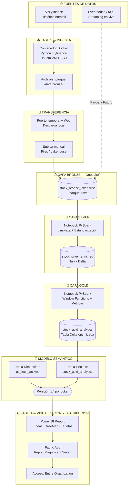

# Informe de Arquitectura y Desarrollo: Pipeline de Datos de los Magnificent Seven en Microsoft Fabric

Este documento detalla de manera integral el ciclo de vida del proyecto de ingeniería de datos desarrollado para la ingesta, procesamiento, enriquecimiento y analítica avanzada de las acciones de los **Magnificent Seven** utilizando un enfoque moderno por capas (Bronze, Silver y Gold) en Microsoft Fabric, combinando datos históricos y de streaming en tiempo real.

---

# Fase 1: Ingesta de datos

## 1. Ingesta Inicial: Contenedor Docker y Almacenamiento Local (Capa Bronze)
El proyecto comenzó con la extracción automatizada de datos históricos del mercado bursátil utilizando la API pública de **yfinance**. 
* **Entorno de Ejecución:** El proceso se configuró dentro de un contenedor de Docker ejecutándose sobre un disco SSD alojado en una máquina virtual con Ubuntu.
* **Persistencia Raw:** Los datos extraídos fueron almacenados localmente en formato `.parquet` dentro de la estructura de la Capa Bronze (`/home/.../data/bronze/`).

---

# Fase 2: Arquitectura Fabric 

## 1. Reto de Conectividad y Migración a Microsoft Fabric (OneLake)
Debido a las restricciones de conectividad y acceso directo entre los archivos locales de la máquina virtual/SSD hacia la nube de Microsoft Fabric, se evaluaron diversas alternativas de volcado:
* **Intento inicial:** Volcar los archivos `.parquet` directamente hacia la máquina host.
* **Solución exitosa:** Se habilitó una descarga por red a través de un puerto temporal y web temporal para extraer los archivos locales, permitiendo subirlos de forma manual pero efectiva a la sección de archivos (`Files`) del Lakehouse en Fabric, denominado **`stock_bronze_lakehouse`**.

---

## 2. Procesamiento y Limpieza (Capa Silver: `stock_silver_enriched`)
Una vez que los datos crudos (*raw*) estuvieron disponibles en el Lakehouse de Bronze en Microsoft Fabric, se creó un Notebook de PySpark para estructurar la **Capa Silver**.
* **Acciones realizadas sobre los datos raw:**
  * Lectura de los archivos Parquet originales.
  * Estandarización de nombres de columnas clave (`ticker`, `date`, `open_price`, `high_price`, `low_price`, `closing_price`, `volume`).
  * Creación de columnas normalizadas como `CleanSymbol` (en mayúsculas) y `CleanDate` (formato fecha estándar) para asegurar la integridad referencial y facilitar los cruces posteriores.
  * Consolidación y guardado como una tabla Delta oficial denominada **`stock_silver_enriched`**.

---

## 3. Analítica Avanzada y Negocio (Capa Gold: `stock_gold_analytics`)
Partiendo de la tabla limpia de la Capa Silver (`stock_silver_enriched`), se desarrolló un segundo Notebook en PySpark para materializar la **Capa Gold**, orientada por completo al análisis financiero y de negocio.
* **Transformaciones y cálculos aplicados:**
  * **Funciones de Ventana (*Window Functions*):** Particionamiento lógico por cada acción (`ticker`) y ordenamiento cronológico por fecha (`date`).
  * **Retorno Diario Porcentual (`Daily_Return_Pct`):** Cálculo del rendimiento intradía mediante la fórmula:
    $$\frac{\text{closing\_price} - \text{open\_price}}{\text{open\_price}} \times 100$$
  * **Brecha de Precios / Volatilidad (`Price_Spread`):** Medición de la amplitud diaria restando el precio mínimo al máximo (`high_price - low_price`).
  * **Media Móvil Simple (`SMA_5`):** Cálculo del promedio móvil simple del precio de cierre en una ventana deslizante de 5 sesiones bursátiles.
  * **Normalización y Persistencia:** Redondeo de métricas a dos decimales y guardado final como tabla Delta optimizada bajo el nombre **`stock_gold_analytics`**, lista para la capa de visualización en Power BI.

---

# Fase 3: Modelado Semántico, Explotación y Distribución en Microsoft Fabric

Este documento detalla la segunda fase del flujo de ingeniería y analítica de datos implementado en Microsoft Fabric. Tomando como base la capa analítica consolidada (Capa Gold), esta fase abarca la estructuración relacional del modelo de datos, la construcción de visualizaciones interactivas en Power BI y la posterior gobernanza y empaquetado de la solución mediante una Aplicación corporativa.

---

## 1. Creación del Modelo Semántico (Semantic Model)

Una vez materializada la tabla analítica en la Capa Gold bajo el nombre `stock_gold_analytics`, se procedió a estructurar el modelo de datos en Microsoft Fabric para dotarlo de contexto de negocio y capacidades relacionales óptimas.

* **Estructura en Estrella (Star Schema):** Se integraron dos entidades principales dentro del entorno de modelado de Fabric:
  1. **Tabla de Hechos (`stock_gold_analytics`):** Contiene los registros transaccionales diarios, precios normalizados y métricas financieras avanzadas calculadas (`Daily_Return_Pct`, `Price_Spread` y la media móvil `SMA_5`).
  2. **Tabla de Dimensiones (`us_tech_activos`):** Aporta los atributos descriptivos de cada activo financiero, permitiendo enriquecer el análisis con el sector tecnológico al que pertenecen y la moneda de transacción (`currency`).
* **Relación y Cardinalidad:** Se estableció una relación relacional activa de **Uno a Varios ($1$ a $*$)** vinculando el campo clave **`ticker`** desde la dimensión de activos hacia la tabla de hechos. Esto asegura una correcta propagación de filtros unidireccionales (`Single`) hacia las métricas financieras sin duplicidad de datos.

---

## 2. Explotación y Visualización de Datos (Power BI Report)

Con el modelo semántico `Magnificent_Seven_Analytics` debidamente configurado, se desarrolló un reporte interactivo en el lienzo web de Power BI con el fin de traducir las métricas técnicas en información visual para la toma de decisiones.

* **Evolución Temporal de Precios:** Gráficos de líneas que trazan el comportamiento de los precios de cierre (`closing_price`) y las medias móviles de corto plazo (`SMA_5`) a lo largo del tiempo para cada componente de los *Magnificent Seven*.
* **Análisis de Volatilidad y Rendimiento:** Tarjetas y gráficos comparativos enfocados en el rendimiento porcentual diario promedio (`Daily_Return_Pct`) y la amplitud de las fluctuaciones de precios mediante el indicador `Price_Spread`.
* **Distribución de Volumen Accionario:** Incorporación de un diagrama de tipo mapa de árbol (*TreeMap*) para dimensionar y comparar de manera visual el volumen total de operaciones (*volume*) agrupado por cada símbolo bursátil.
* **Segmentación Dinámica:** Inclusión de filtros contextuales por fecha, ticker, sector y moneda.

---

## 3. Gobernanza, Empaquetado y Distribución (Fabric App)

Para finalizar el ciclo de vida del dato y garantizar un acceso seguro y controlado para los usuarios finales, se empaquetó la solución analítica en una estructura corporativa:

* **Creación de la Aplicación de Fabric:** A partir del espacio de trabajo (*Workspace*), se consolidó el reporte analítico en una **Fabric App** bajo el nombre de *Report Magnificent Seven*.
* **Gestión de Audiencias y Permisos:** Se configuró el acceso para la organización (*Entire organization*), asegurando que cualquier miembro autorizado con el enlace corporativo pueda interactuar con el cuadro de mando.
* **Separación de Entornos:** La publicación de la aplicación aísla a los consumidores finales de la lógica de desarrollo subyacente (notebooks de transformación y tablas en bruto de las capas Bronze/Silver), ofreciendo una interfaz limpia, profesional y orientada estrictamente al consumo analítico.

---
## . Incidencias Técnicas, Retos y Soluciones

Durante el desarrollo del proyecto se presentaron diversos retos técnicos que fueron superados estratégicamente:
1. **Problemas de Contexto en Spark (`Bloqueos y Peticiones Denegadas`):**
  * *Causa:* Durante las consultas masivas a la API de yfinance, el sistema comenzó a denegar las solicitudes (requests denied) debido a políticas de limitación de tasa (rate limiting) y detección de scraping automatizado.
  * *Solución:* Se modificó el script de extracción en Python para ampliar el tiempo de espera entre consulta y consulta (sleep intervals), incorporando además un factor de aleatoriedad temporal entre las peticiones. Esto permitió simular un comportamiento de navegación humano y natural, evitando con éxito los bloqueos del servidor y asegurando una descarga limpia de los datos.
2. **Problemas de Contexto en Spark (`No default context found`):**
   * *Causa:* Los Notebooks se ejecutaban sin un Lakehouse adjunto por defecto.
   * *Solución:* Se asoció explícitamente el Lakehouse correspondiente desde el panel lateral de cada Notebook, resolviendo el direccionamiento del espacio de nombres en OneLake.
3. **Errores de Autenticación con el Conector Kusto (`ClientAuthenticationException`):**
   * *Causa:* Conflictos de credenciales al intentar conectar directamente Spark con el Eventhouse en tiempo real.
   * *Solución:* Se optó por una arquitectura híbrida simplificada, exportando los datos recientes del Eventhouse en formato CSV, subiéndolos al Lakehouse e integrándolos mediante operaciones nativas en Spark.
4. **Intentos de Ingesta en Streaming en Vivo:**
   * *Contexto:* Se configuró un Eventhouse y consultas KQL utilizando sintaxis estricta para campos con caracteres especiales (ej. `todatetime(['time'])`) para capturar eventos recientes. Sin embargo, priorizando la estabilidad y velocidad de desarrollo para la culminación analítica, se decidió enfocar el núcleo principal en los datos históricos enriquecidos, dejando las bases preparadas para futuras activaciones del pipeline en tiempo real.


# 📈 Magnificent Seven Analytics — Pipeline de Datos en Microsoft Fabric

[](https://app.fabric.microsoft.com/)
[](https://spark.apache.org/)
[](https://www.python.org/)
[](https://powerbi.microsoft.com/)
[](#-licencia)

Pipeline de ingeniería de datos **end-to-end** para la ingesta, procesamiento, enriquecimiento y analítica avanzada de las acciones de los **Magnificent Seven** (AAPL, MSFT, GOOGL, AMZN, NVDA, META, TSLA), implementado bajo una **arquitectura medallion (Bronze → Silver → Gold)** en **Microsoft Fabric**.

---

## 📑 Tabla de contenidos

- [🎯 Objetivo del proyecto](#-objetivo-del-proyecto)
- [🏗️ Arquitectura del pipeline](#️-arquitectura-del-pipeline)
- [🧩 Stack tecnológico](#-stack-tecnológico)
- [📂 Estructura del repositorio](#-estructura-del-repositorio)
- [🚀 Flujo por fases](#-flujo-por-fases)
  - [Fase 1 — Ingesta](#fase-1--ingesta)
  - [Fase 2 — Arquitectura Fabric](#fase-2--arquitectura-fabric)
  - [Fase 3 — Modelado y distribución](#fase-3--modelado-y-distribución)
- [📐 Métricas de negocio (Capa Gold)](#-métricas-de-negocio-capa-gold)
- [⚠️ Incidencias técnicas y soluciones](#️-incidencias-técnicas-y-soluciones)
- [🗺️ Roadmap](#️-roadmap)
- [⚙️ Automatización del diagrama (GitHub Action)](#️-automatización-del-diagrama-github-action)
- [🤝 Contribuciones](#-contribuciones)
- [📜 Licencia](#-licencia)

---

## 🎯 Objetivo del proyecto

Construir una solución analítica corporativa que permita:

- **Centralizar** datos históricos bursátiles de los *Magnificent Seven* en un Lakehouse.
- **Estandarizar y enriquecer** los datos mediante transformaciones PySpark.
- **Calcular métricas financieras avanzadas** (rendimiento diario, volatilidad, media móvil).
- **Exponer la información** a través de un modelo semántico y un reporte interactivo en Power BI.
- **Distribuir** el cuadro de mando mediante una **Fabric App** con acceso corporativo.

---

## 🏗️ Arquitectura del pipeline



> 📎 La versión SVG exportada se encuentra en [`docs/architecture.svg`](docs/architecture.svg) (generada automáticamente por CI).

---

## 🧩 Stack tecnológico

| Categoría | Tecnología |
| :--- | :--- |
| **Origen de datos** | API pública `yfinance` |
| **Ingesta** | Docker · Python · Ubuntu VM · SSD |
| **Almacenamiento raw** | `.parquet` (Capa Bronze) |
| **Plataforma analítica** | Microsoft Fabric · OneLake |
| **Procesamiento** | Notebooks PySpark (Fabric) |
| **Formato tabla** | Delta Lake |
| **Modelado** | Semantic Model (Star Schema) |
| **Visualización** | Power BI |
| **Distribución** | Fabric App |
| **Streaming (roadmap)** | Eventhouse · KQL |

---

## 📂 Estructura del repositorio

```
magnificent-seven-analytics/
├── README.md
├── docs/
│   ├── architecture.mmd          # Código fuente Mermaid
│   ├── architecture.svg          # Diagrama exportado (CI)
│   └── img/
├── notebooks/
│   ├── 01_bronze_ingesta.py      # Script de ingesta en Docker
│   ├── 02_silver_cleaning.ipynb  # PySpark — Limpieza
│   └── 03_gold_analytics.ipynb   # PySpark — Métricas financieras
├── docker/
│   ├── Dockerfile
│   └── docker-compose.yml
├── .github/
│   └── workflows/
│       └── mermaid-to-svg.yml    # GitHub Action
└── LICENSE
```

---

## 🚀 Flujo por fases

### Fase 1 — Ingesta

1. **Entorno de ejecución:** contenedor Docker sobre disco SSD en VM Ubuntu.
2. **Extracción:** consultas automatizadas a la API de `yfinance` para los 7 tickers.
3. **Persistencia raw:** archivos `.parquet` en `/data/bronze/`.

**Mitigación de rate limiting:**

```python
import time, random
from yfinance import Ticker

for ticker in TICKERS:
    data = Ticker(ticker).history(period="10y")
    data.to_parquet(f"/data/bronze/{ticker}.parquet")
    time.sleep(random.uniform(2, 5))  # jitter aleatorio
```

### Fase 2 — Arquitectura Fabric

| Capa | Objeto | Descripción |
| :--- | :--- | :--- |
| 🥉 **Bronze** | `stock_bronze_lakehouse` | Archivos `.parquet` crudos subidos a `Files` |
| 🥈 **Silver** | `stock_silver_enriched` | Tabla Delta normalizada (`CleanSymbol`, `CleanDate`) |
| 🥇 **Gold** | `stock_gold_analytics` | Métricas financieras avanzadas |

> ⚠️ **Reto de conectividad:** por restricciones de red entre la VM/SSD y OneLake, la transferencia se realizó mediante un **puerto temporal + descarga web**, seguida de una subida manual al Lakehouse.

### Fase 3 — Modelado y distribución

- **Modelo Semántico:** `Magnificent_Seven_Analytics` con relación **1 : \*** desde `us_tech_activos` (dim) hacia `stock_gold_analytics` (fact) por `ticker`.
- **Reporte Power BI:** líneas de evolución, tarjetas de rendimiento, TreeMap de volumen, segmentadores.
- **Fabric App:** `Report Magnificent Seven` publicada para *Entire Organization*.

---

## 📐 Métricas de negocio (Capa Gold)

```text
Daily_Return_Pct = ((closing_price − open_price) / open_price) × 100

Price_Spread     = high_price − low_price

SMA_5            = AVG(closing_price) OVER (
                     PARTITION BY ticker
                     ORDER BY date
                     ROWS BETWEEN 4 PRECEDING AND CURRENT ROW
                   )
```

Todas las métricas se redondean a **2 decimales** antes de su persistencia como tabla Delta optimizada.

---

## ⚠️ Incidencias técnicas y soluciones

| # | Incidencia | Causa | Solución aplicada |
| :--- | :--- | :--- | :--- |
| 1 | Requests denegadas (`rate limiting`) | Detección de scraping por `yfinance` | `sleep` + jitter aleatorio entre peticiones |
| 2 | `No default context found` | Notebook sin Lakehouse asociado | Asociación explícita del Lakehouse en el panel lateral |
| 3 | `ClientAuthenticationException` (Kusto) | Conflicto de credenciales Spark ↔ Eventhouse | Export CSV → Lakehouse → operaciones nativas en Spark |
| 4 | Streaming en vivo | Complejidad + priorización de entrega | Arquitectura híbrida; base preparada para activación futura |

---

## 🗺️ Roadmap

- [x] Ingesta histórica automatizada vía `yfinance`
- [x] Capa Bronze en OneLake
- [x] Capa Silver con estandarización
- [x] Capa Gold con métricas financieras
- [x] Modelo semántico en Fabric
- [x] Reporte Power BI + Fabric App
- [ ] Activación completa del pipeline de **streaming en vivo** (Eventhouse + KQL)
- [ ] Orquestación con **Fabric Data Pipelines**
- [ ] Alertas automáticas por umbral de volatilidad (`Price_Spread`)
- [ ] CI/CD para notebooks (Fabric Git Integration)

---

## ⚙️ Automatización del diagrama (GitHub Action)

El archivo [`docs/architecture.mmd`](docs/architecture.mmd) contiene el código fuente Mermaid. Cada `push` que lo modifique dispara la generación automática del SVG.

### `.github/workflows/mermaid-to-svg.yml`

```yaml
name: Generate Mermaid SVG

on:
  push:
    paths:
      - 'docs/architecture.mmd'
      - '.github/workflows/mermaid-to-svg.yml'
  workflow_dispatch:

permissions:
  contents: write

jobs:
  build:
    runs-on: ubuntu-latest
    steps:
      - name: Checkout
        uses: actions/checkout@v4

      - name: Setup Node.js
        uses: actions/setup-node@v4
        with:
          node-version: '20'

      - name: Install Mermaid CLI
        run: npm install -g @mermaid-js/mermaid-cli

      - name: Render SVG
        run: |
          mmdc \
            -i docs/architecture.mmd \
            -o docs/architecture.svg \
            -b transparent \
            -t default

      - name: Commit SVG
        run: |
          git config user.name "github-actions[bot]"
          git config user.email "github-actions[bot]@users.noreply.github.com"
          git add docs/architecture.svg
          git diff --staged --quiet || git commit -m "docs: regenerate architecture.svg [skip ci]"
          git push
```

> 💡 **Paso previo:** guarda el bloque Mermaid en `docs/architecture.mmd` (sin las triples comillas). El workflow lo convertirá a `docs/architecture.svg` en cada cambio.

---

## 🤝 Contribuciones

Las contribuciones son bienvenidas. Por favor:

1. Haz **fork** del repositorio.
2. Crea una rama: `git checkout -b feature/nueva-funcionalidad`.
3. Realiza **commits** descriptivos siguiendo [Conventional Commits](https://www.conventionalcommits.org/).
4. Abre un **Pull Request** describiendo el cambio.

---

## 📜 Licencia

Este proyecto se distribuye bajo la licencia **MIT**. Consulta el archivo [`LICENSE`](LICENSE) para más información.

---

<div align="center">

**Desarrollado con 🐳 Docker · ⚡ PySpark · 🧠 Microsoft Fabric · 📊 Power BI**

</div>